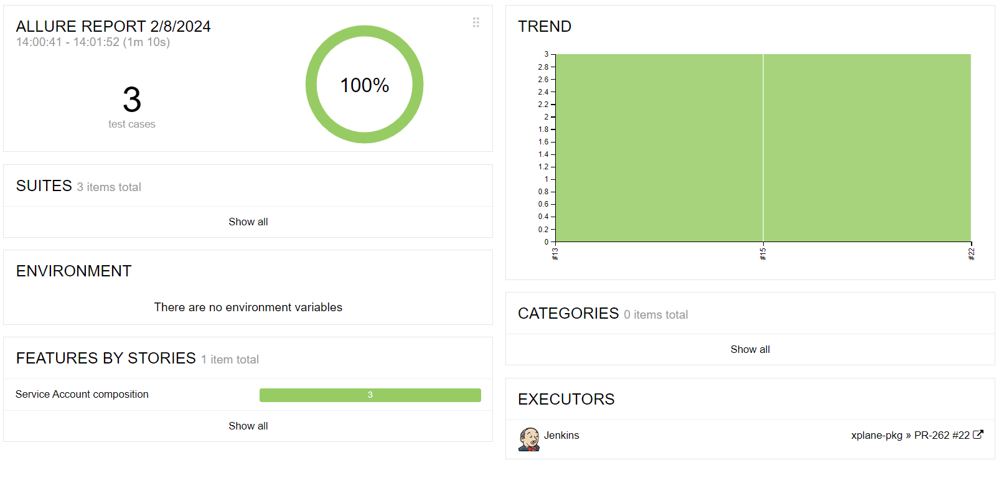
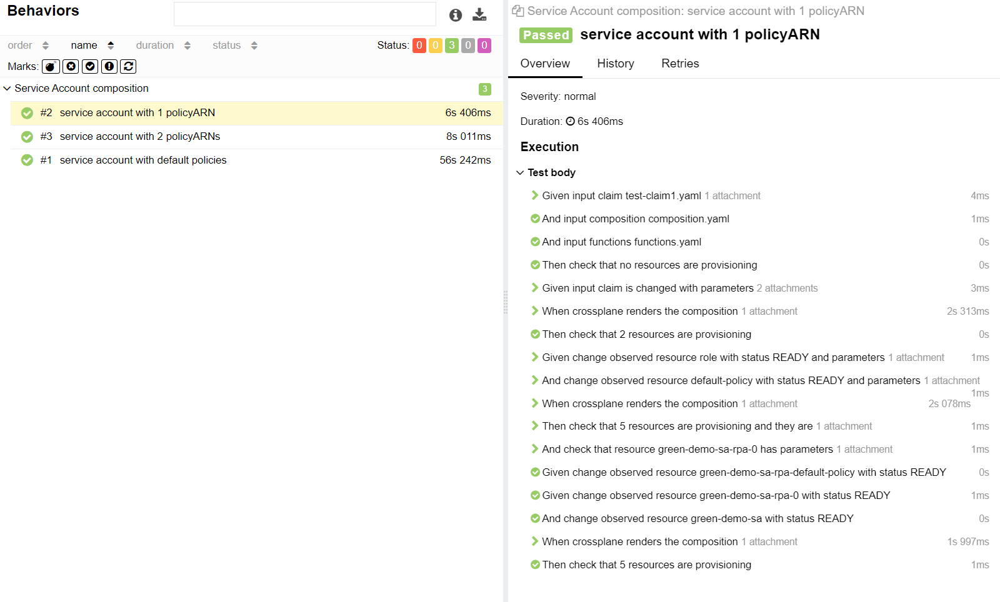

# Crossplane Composition Tester
Test Crossplane compositions implemented with composition functions using BDD (Behavior Driven Development). 
If you're not familiar with BDD, check out [this](https://cucumber.io/docs/bdd/). 

[Cucumber](https://cucumber.io/docs/guides/overview/) is a popular BDD framework for testing. It follows the 
[Gherkin](https://cucumber.io/docs/gherkin/) syntax for writing tests (Given, When, Then).
To run the tests, we use [behave](https://behave.readthedocs.io/en/stable/) which 
is a python implementation of Cucumber. We also use Python to implement the steps of the tests.


## Installation

Requirements:
- **Python 3.10+** (the Docker image uses Python 3.12)
- **[Crossplane CLI](https://docs.crossplane.io/latest/cli/) v2.0.8 or newer**: `tests_runner.sh` checks the minimum version (tested with v2.0.8, v2.3.4 and v2.5.0, see [Crossplane CLI versions](#crossplane-cli-versions))
- **Docker** (or Podman): the composition functions run locally as containers

```bash
git clone https://github.com/swisscom/crossplane-composition-tester.git
cd crossplane-composition-tester

# Install the python dependencies (behave, allure-behave, ...) in a virtual environment
python3 -m venv venv
source venv/bin/activate
pip install -r requirements.txt

# Install the Crossplane CLI (v2.0.8 or newer; set XP_VERSION to the version you want)
curl -sL "https://raw.githubusercontent.com/crossplane/crossplane/main/install.sh" | XP_VERSION=v2.0.8 sh
sudo mv crossplane /usr/local/bin
crossplane version --client   # Client Version: v2.0.8
```

### Crossplane CLI versions
`tests_runner.sh` requires the Crossplane CLI **v2.0.8 or newer** and fails with an error on older versions.
- **v2.0.8 – v2.2.x** render locally and are the fastest option.
- **v2.3 and newer**: the CLI moved to the [crossplane/cli](https://github.com/crossplane/cli) repository. `render` now runs the Crossplane
  render engine in a Docker container, so it needs a running Docker daemon and takes a few seconds per render. The schema
  validation command was renamed from `crossplane beta validate` to `crossplane resource validate`; the tester detects which one is available.
- The [Docker image](#running-in-docker-or-kubernetes) uses v2.0.8, because newer versions can't render inside a container without access to a Docker daemon.


## Quick start
The `test` folder contains two example compositions, laid out like a real compositions project:
compositions and XRDs in `test/pkg/<composition>`, and their tests in `test/composition-tests/<composition>`.

The main example is a [composition for a service account](test/pkg/service-account-with-functions/composition.yaml). It creates the following resources:
- a `Role`
- a default `Policy`
- a `RolePolicyAttachment` for the default policy and for each policy ARN provided in the claim, **once the role and the policies are ready**
- a `ServiceAccount` object **once the role is ready**

Explore the [feature file](test/composition-tests/service-account-with-functions/service-account.feature) to get an idea
of how to write features and test different use cases.

Run the tests with the `tests_runner.sh` script:
```bash
./tests_runner.sh test
```

The script checks the Crossplane CLI version and starts the composition functions as docker containers.
It then runs every feature directory in parallel and stops the containers at the end. The expected output is:
```
Discovered 2 feature directories under .target_project/composition-tests
Running with 2 parallel workers. Full logs in: logs/

[  1/2] PASS xrd-defaulting                           3 passed                       (  0.3s)
[  2/2] PASS service-account-with-functions           3 passed                       (  1.7s)
2 feature directories: 2 passed, 0 failed | scenarios: 6 passed, 0 failed | took 0m01.7s
```

To test your own compositions, point the script to your compositions project. The project must contain
a `pkg` folder, and a tests folder (default: `composition-tests`) with the `functions.yaml` file:
```bash
./tests_runner.sh ../my-compositions-project
./tests_runner.sh --help   # all options: tags, debug mode, coverage, parallelism, reports
```

### Running behave directly
`tests_runner.sh` is a convenience wrapper. You can also run `behave` directly once the function containers are running:
```bash
./start_functions.sh               # start the composition functions on localhost:9443-9445
behave test                        # run all features
behave test/composition-tests/xrd-defaulting   # or a single feature directory
behave test -t @critical           # or only the scenarios with a tag
docker rm -f function-go-templating-host function-auto-ready-host function-environment-configs-host   # cleanup
```
Use `./tests_runner.sh -s test` to keep the function containers running after the tests.

Run `behave --help` to see the available options. Useful ones include `--tags` or `-t`, which runs only the scenarios with a certain tag. Some tags related to the severity
of a scenario or feature, like "minor" or "critical", are specific to test reporting tools like [allure](https://github.com/allure-framework/allure-python/blob/master/allure-behave/examples/severity.rst).

**Note**: IDEs like PyCharm have built-in support for behave and other BDD frameworks, so you can run the tests directly from the IDE.

### Composition functions
The functions used by your compositions are declared in `functions.yaml`, at the root of the tests folder
(`test/composition-tests/functions.yaml`). Each function uses the `Development` runtime and points to
the address where its container listens. `tests_runner.sh` and `start_functions.sh` start the following functions:

| Function | Image | Address |
|----------|-------|---------|
| function-go-templating | `xpkg.crossplane.io/crossplane-contrib/function-go-templating:v0.12.5` | `localhost:9443` |
| function-auto-ready | `xpkg.crossplane.io/crossplane-contrib/function-auto-ready:v0.7.0` | `localhost:9444` |
| function-environment-configs | `xpkg.crossplane.io/crossplane-contrib/function-environment-configs:v0.8.0` | `localhost:9445` |

If your compositions use other functions, add them to the `FUNCTION_DOCKER_INSTANCES` list in `tests_runner.sh` and to your `functions.yaml`.

### Claims and composite resources
`crossplane render` renders a **composite resource (XR)**, not a claim. The file given with `Given input claim <CLAIM>`
must therefore have the XR kind of your XRD (e.g. `XSrvAccount`, not the claim kind `SrvAccount`). See the
[example](test/composition-tests/service-account-with-functions/resources/claim.yaml).

### Running in Docker or Kubernetes
The [Dockerfile](Dockerfile) packages the tester with Crossplane CLI v2.0.8 (see [Crossplane CLI versions](#crossplane-cli-versions)). Its entrypoint is `behave`.
- [examples/docker/run.sh](examples/docker/run.sh) builds the image, starts the functions on a shared docker network and runs the [examples/test](examples/test) suite.
- [examples/kubernetes](examples/kubernetes) runs the functions as deployments and the tester as a job.

In both cases the functions are reached by their container or service name, so the
[functions.yaml of the examples](examples/test/composition-tests/functions.yaml) targets `function-go-templating:9443` instead of `localhost:9443`.

## Parallel Execution & Console Output

`tests_runner.sh` runs the feature directories **in parallel** (via `parallel_runner.py`): each feature
directory is executed by its own `behave` worker process, with a bounded pool of workers
(default: number of CPUs, capped at 10). Use `-j/--jobs` to control the parallelism:

```bash
# run with 4 parallel workers
./tests_runner.sh -j 4 ../my-compositions-project

# run sequentially with live streaming output (direct behave)
./tests_runner.sh -j 1 ../my-compositions-project
```

### Parallel mode (`-j 2` or higher, default)

The console output is focused on failures: one progress line per feature directory, and a
**failure summary** at the end with the failing scenarios and their assertion messages.
The full `behave` output of every feature directory is always captured to `logs/<feature-dir>.log`,
so nothing is lost:

```
Discovered 45 feature directories under .target_project/composition-tests
Running with 8 parallel workers. Full logs in: logs/

[  1/45] PASS s3                              12 passed                 ( 34.2s)
[  2/45] FAIL rds-aurora                       7 passed, 2 failed       ( 51.0s)  log: logs/rds-aurora.log
...

========================= FAILURE SUMMARY =========================

✗ rds-aurora  logs/rds-aurora.log
  Then check that 2 resources are provisioning
    ASSERT FAILED: expected 2 resources, got 1: ['cluster']
  Failing scenarios:
    .target_project/composition-tests/rds-aurora/rds-aurora.feature:23  Cluster with replicas
```

Useful flags:
- `-v/--verbose`: print the full behave output of each feature directory as it completes

### Sequential mode (`-j 1`)

Runs `behave` directly with live streaming output — you see each step as it executes.
No per-feature log files are produced.
This is useful for debugging individual failures interactively.

You can also invoke the parallel runner directly (it expects the function hosts to be running):
```bash
python3 parallel_runner.py .target_project/composition-tests --jobs 8 -t s3
```

Plain `behave` still works for running a single feature during development (see [Running behave directly](#running-behave-directly)):
```bash
behave test/composition-tests/service-account-with-functions
```

### Reports
On CI (when `COMPOSITION_TESTER_FUNCTIONS_FILE` is set), or locally with `-r/--all-reports`, the runner also writes
JUnit (`reports/`), Allure (`allure-results/`) and Cucumber JSON (`cucumber-reports/`) reports.
Here is an example output with the Jenkins allure plugin






## Parameter Coverage

The composition tester includes a **parameter coverage** feature that helps you identify which parameters from your Crossplane composition definitions are actually tested by your test suite.

### What is Parameter Coverage?

Parameter coverage measures how thoroughly your tests exercise the parameters defined in your composition's `definition.yaml` file. It answers the question: *"Are we testing all the configurable parameters of our compositions?"*

The coverage tool:
1. **Extracts all available parameters** from each composition's `definition.yaml` file (from the `openAPIV3Schema` specification)
2. **Scans all test resources** in the corresponding test directory:
   - Claim YAML files in the `resources/` folder
   - Gherkin feature files with parameter tables (e.g., `Given input claim is changed with parameters`)
3. **Calculates coverage** by comparing which parameters are actually used in tests versus what's available
4. **Generates a comprehensive report** showing covered and uncovered parameters for each composition

### How Coverage Works

- **Cumulative across all tests**: Coverage is calculated across ALL claim files and feature files in a composition's test directory, not just individual test cases
- **Runs on full test suite**: Even if you run tests on a specific subfolder using `behave composition-tests/my-composition`, the coverage analysis always runs on the entire test suite to ensure comprehensive reporting
- **Hierarchical parameter tracking**: Nested parameters are tracked with dot notation (e.g., `versioningConfiguration.status`, `policiesARN`)

### Running Coverage

Enable coverage mode with the `-c/--coverage` flag of the runner, an environment variable, or behave's userdata flag:

```bash
# Using the tests runner
./tests_runner.sh --coverage test

# Using environment variable
export COMPOSITION_TESTER_COVERAGE=true
behave test

# Using behave userdata flag
behave test -D coverage=true

# Or both (either will work)
COMPOSITION_TESTER_COVERAGE=true behave test -D coverage=true
```

### Coverage Output

After tests complete, you'll see:

1. **Console summary** with coverage percentage and lists of covered/uncovered parameters per composition
2. **Requirements validation**: each composition is rated against minimum coverage thresholds (minimal / medium / high levels, defined in [`steps/coverage/requirements_validator.py`](steps/coverage/requirements_validator.py))
3. **JSON report** saved to `coverage-report.json` and **YAML report** saved to `coverage-report.yaml`, in the parent directory of the compositions project (the tester directory when running `./tests_runner.sh test` or `behave test`)
4. **Allure integration** with a dedicated "Coverage Summary" entry in the Allure results

Coverage expects the default project layout: compositions in `pkg/<composition>/` and tests in `composition-tests/<composition>/`.

Example output:
```
================================================================================
CROSSPLANE COMPOSITION COVERAGE REPORT
================================================================================

📋 PARAMETER COVERAGE BY COMPOSITION
--------------------------------------------------------------------------------

  Composition: s3
    Total Parameters:   15
    Covered Parameters: 12
    Coverage:           80.0%
    ✓ Covered: bucketName, region, versioningConfiguration.status, lifecycleConfiguration ...
    ✗ Uncovered: accelerateConfiguration, intelligentTieringConfigurations, metrics
```

### Benefits

- **Identify gaps in test coverage**: Quickly spot parameters that aren't being tested
- **Improve test quality**: Ensure critical configuration options are validated
- **Track progress**: Monitor coverage improvements over time
- **Documentation**: Coverage reports serve as documentation of what's tested


## Motivation
Crossplane compositions can become complex and in turn very error-prone.
So far, there hasn't been a clear or easy way to test your crossplane compositions in a quick and reproducible way
other than to test them live in a cluster. This is not ideal for a few reasons:
- It can be a very slow process depending on the composition
- It's not easy to debug
- It does not allow you to test with different combination of inputs (i.e. different configurations).

This tool aims to solve this problem by allowing you to test your compositions locally and quickly, as well as define tests
in a way that is easy to read and reason about. This tool relies on two main components:
- [behave](https://behave.readthedocs.io/en/stable/) - A python implementation of Cucumber, that allows you to define your tests in plain english
in a BDD (Given, When, Then) format. 
- Crossplane [composition functions](https://docs.crossplane.io/latest/concepts/composition-functions/).

The Crossplane v1.14 release introduced a new major feature, [composition functions](https://docs.crossplane.io/latest/concepts/composition-functions/).
Composition functions allow you to define your composition programmatically using a language of your choice (python, go, etc). 
It came accompanied by the very convenient [render command in the crossplane CLI](https://docs.crossplane.io/latest/concepts/composition-functions/#test-a-composition-that-uses-functions).
Given a composition that uses composition functions, this command allows you to render it locally without having to spin up a kubernetes cluster and
see the output that will be passed to the providers if you were to run it inside a cluster.

Combining both the power of the crossplane `render` command and the BDD approach, we now have a very powerful and expressive way
to test our compositions. In the end, whether you write your compositions in yaml or as code with the new composition functions feature,
this tool can become very valuable in validating your compositions with different use cases.

## Features
Check [the features README in the docs](docs/features.md) to get an overview of how to write features and the rationale behind them in the context of testing Crossplane compositions.

## How it works
Check [how this tool works](docs/how_it_works.md).

## CI/CD Integration
`Behave` has very good integration with test-reporting tools like [Allure](https://allurereport.org/). 

For example in Jenkins, you can install the [Allure plugin](https://plugins.jenkins.io/allure-jenkins-plugin/), and
then run the `tests_runner.sh` script which will run the tests with `behave` and generate allure-reports that can 
then be viewed in Jenkins as seen in [Reports](#reports).

## Features Reference

This is an overview of all the steps that are currently supported. More can be added later.

### Given (Arrange)

| Step | Description |
|------|-------------|
| `Given input claim <CLAIM>` | Provide the name of the claim file to be used in the test. Claims should be stored inside the `resources` subfolder inside each feature folder. The file must have the composite resource (XR) kind, see [Claims and composite resources](#claims-and-composite-resources). NOTE: Executing this step will load a new claim and will reset any prepared observed state from previous steps. |
| `Given input composition <COMPOSITION FILE>` | Provide the name of the composition file. By default, the composition should be named `composition.yaml`. Compositions should be stored inside the `pkg/<RESOURCE>` directory of the project. This step is OPTIONAL. |
| `Given input definition <DEFINITION FILE>` | The name of the xrd (Composite Resource Definition) file. This is to be used in conjunction with steps that assert schema validation for input claim or xr. |
| `Given input composition directory <COMPOSITION DIRECTORY> and file <COMPOSITION FILE>` | Provide the name of the composition directory and file. The composition file is looked up in `pkg/<COMPOSITION DIRECTORY>/<COMPOSITION_FILE>`. This step is OPTIONAL. |
| `Given input composition directory <COMPOSITION DIRECTORY> and definition file <DEFINITION FILE>` | Provide the name of the composition directory and the xrd definition file. The definition file is looked up in `pkg/<COMPOSITION DIRECTORY>/<DEFINITION_FILE>`. This step is OPTIONAL. |
| `Given input composition directory <COMPOSITION DIRECTORY>` | Use `pkg/<COMPOSITION DIRECTORY>` as the composition directory of the scenario: its `composition.yaml` and `definition.yaml` become the defaults, and subsequent `input composition <FILE>` / `input definition <FILE>` steps look up their files in it. Useful when a test directory does not mirror the `pkg` directory. This step is OPTIONAL. |
| `Given input functions <FUNCTIONS>` | Provide the name of the functions file to be used with the tests. Function files should be stored at the root of the test directory containing the feature files directories of the project (e.g. `test/composition-tests/functions.yaml`). By default, the tests will use the `functions.yaml` file to run the tests. The functions file should contain all the functions needed to run the tests. However, one can keep multiple versions of the functions file, and in that case use this step to specify which version to use for the tests. This step is OPTIONAL. |
| <pre><code>Given input claim is changed with parameters</code><br><code>\| param name \| param value \|</code><br><code>\| param-1 \| value-1 \|</code><br><code>\| param-2 \| value-2 \|</code></pre> | Updates the claim with the parameters provided in the data table. |
| <pre><code>Given change observed xr with parameters</code><br><code>\| param name \| param value \|</code><br><code>\| param-1 \| value-1 \|</code><br><code>\| param-2 \| value-2 \|</code></pre> | Update the XR (composite) with parameters from the table. |
| `Given input compositions directory <COMPOSITIONS_DIRECTORY>` | Prepare working directory with the compositions for the test. This handles cases where compositions are located in a different directory than the default /pkg directory. This step is OPTIONAL. |
| `Given input environment config <ENVCONFIG FILE>` | Provide the name of the environment config file if the composition uses any. By default, the `envconfig.yaml` file at the root of the tests folder is used when it exists. `Given input environment config <ENVCONFIG FILE> file` is an equivalent form. This step is OPTIONAL. |
| `Given input observed state <OBSERVED STATE FILE> for next rendering` | Provide the observed state file which contains the list of resources to be used as the observed state for the next render step. NOTE: This will reset any prepared observed state from previous steps. |
| `Given change all observed resources with status <READY_STATUS>` | Sets the ready status of all resources in the current observed state. |
| `Given change observed resource <RESOURCE_NAME> with status <READY_STATUS>` | Sets the ready status of the given resource in the current observed state. |
| <pre><code>Given change following observed resources with status <READY_STATUS></code><br><code>\| resource-name \|</code><br><code>\| resource-1 \|</code><br><code>\| resource-2 \|</code></pre> | Sets the ready status of the given resources in the current observed state. |
| <pre><code>Given change observed resource <RESOURCE_NAME> with parameters</code><br><code>\| param name \| param value \|</code><br><code>\| param-1 \| value-1 \|</code><br><code>\| param-2 \| value-2 \|</code></pre> | Update or set the parameters of the given resource in the current observed state. |
| <pre><code>Given change observed resource <RESOURCE_NAME> with status <READY_STATUS> and parameters</code><br><code>\| param name \| param value \|</code><br><code>\| param-1 \| value-1 \|</code><br><code>\| param-2 \| value-2 \|</code></pre> | Sets the ready status of the given resource in the current observed state and update its parameters. |
| `Given change observed resource <RESOURCE_NAME> with parameters from values file <VALUES_FILE>` | Update or set the parameters of the given resource from a YAML file stored in the `resources/` directory. This is useful for multiline strings or complex parameter values that are hard to write in feature files. The VALUES_FILE should contain a YAML dictionary of parameter updates. |
| `Given change observed resource <RESOURCE_NAME> with status <READY_STATUS> and parameters from values file <VALUES_FILE>` | Sets the ready status of the given resource and updates its parameters from a YAML file.  |

### When (Act)

| Step                                      | Description                                                |
|-------------------------------------------|------------------------------------------------------------|
| `When crossplane renders the composition` | We apply the claim with the current observed state, if any. The definition is auto-resolved from `pkg/<feature-directory>/definition.yaml` and passed to `crossplane render --xrd`, so the XRD's schema **defaults** (and pruning) are applied to the XR before composing — matching cluster behavior and letting claims omit defaulted values. `--xrd` is always-on for compositions that have a `definition.yaml`; use `Given input definition <file>` only to override the auto-resolved path. |

### Then (Assert)

| Step                                                                                                                                                                                                                | Description                                                                                                                                                 |
|---------------------------------------------------------------------------------------------------------------------------------------------------------------------------------------------------------------------|-------------------------------------------------------------------------------------------------------------------------------------------------------------|
| `Then check that the claim is valid` | Validate the input claim against the definition schema using `crossplane resource validate` (`crossplane beta validate` before CLI v2.3). A claim whose kind has no schema in the given definition fails loudly instead of silently passing. |
| `Then check that the claim is invalid` | Assert that the input claim is invalid against the definition schema. |
| `Then check that the xr is valid` | Validate the XR (composite resource) against the definition schema using `crossplane resource validate` (`crossplane beta validate` before CLI v2.3). |
| `Then check that the xr is invalid` | Assert that the XR is invalid against the definition schema. |
| `Then crossplane rendering fails with message containing <MESSAGE>` | Render the composition and assert that the rendering fails with an error output containing `<MESSAGE>`. Use it to test the error paths of your composition. |
| `Then check that no resources are provisioning` | Check that no resources are being provisioned. |
| `Then check that <NUMBER> resources are provisioning` (or `Then check that 1 resource is provisioning`)                                                                                                                                                               | Check that a number of resources are being provisioned after we apply a claim.                                                                              |
| <pre><code>Then check that <NUMBER> resources are provisioning and they are</code><br><code>\| resource-name \|</code><br><code>\| resource-1 \|</code><br><code>\| resource-2 \|</code></pre>                      | Check that a number of resources are being provisioned after we apply a claim and check that their names are equal to the ones you provide in the data table. For a single resource, use `Then check that 1 resource is provisioning and it is`. |
| <pre><code>Then check that resource <RESOURCE_NAME> has parameters</code><br><code>\| param name \| param value \| </code><br><code>\| param-1 \| value-1 \|</code><br><code>\| param-2 \| value-2 \| </code></pre> | Check that a provisioned resource has the parameters you provide in the data table.                                                                         |
| <pre><code>Then check that resource <RESOURCE_NAME> has parameters with key prefix <KEY></code><br><code>\| param name \| param value \| </code><br><code>\| param-1 \| value-1 \|</code></pre> | Check that a provisioned resource has the parameters under a specific key prefix you provide in the data table. |
| `Then check that resource <RESOURCE_NAME> has parameter <PARAM_NAME> equal to value in file <VALUES_FILE>` | Check that a parameter of a provisioned resource equals the content of a file stored in the `resources/` directory. Useful for multiline values like policy documents. |
| <pre><code>Then check that resource <RESOURCE_NAME> does not have parameters</code><br><code>\| param name \|</code><br><code>\| param-1 \|</code><br><code>\| param-2 \|</code></pre> | Check that a provisioned resource does not have the parameters you provide in the data table. |
| <pre><code>Then check that resource <RESOURCE_NAME> does not have parameters with key prefix <KEY></code><br><code>\| param name \|</code><br><code>\| param-1 \|</code><br><code>\| param-2 \|</code></pre> | Check that a provisioned resource does not have the parameters under a specific key prefix. |
| <pre><code>Then check that resource <RESOURCE_NAME> has array parameters of length</code><br><code>\| param name \| length \| </code><br><code>\| param-1 \| 3 \|</code></pre> | Check that a provisioned resource has array parameters with specific lengths. Data table format: param name, length columns. |
| <pre><code>Then check that xr has status parameters</code><br><code>\| param name \| param value \|</code><br><code>\| param-1 \| value-1 \|</code><br><code>\| param-2 \| value-2 \|</code></pre> or <pre><code>Then check that composite has status parameters</code><br><code>\| param name \| param value \|</code><br><code>\| param-1 \| value-1 \|</code><br><code>\| param-2 \| value-2 \|</code></pre> | Check that the XR/composite has status parameters you provide in the data table. |

### Debugging helpers

| Step | Description |
|------|-------------|
| `Then log desired resources` | Print the names of the desired resources of the last render. |
| `Then fail here` | Fail the scenario on purpose, e.g. to inspect the render inputs and outputs dumped in debug mode (`./tests_runner.sh -d`). |

Parameter names use dot notation (`spec.forProvider.roleName`). Escape dots that are part of a key with `\.`
(e.g. `metadata.labels.crossplane\.io/claim-name`). In data tables, parameter values support the commands
`\\list a,b`, `\\bool true`, `\\int 3` and `\\nil` to set typed values (the backslash is doubled because Gherkin tables unescape `\\`).

## Built With
- [Crossplane CLI](https://docs.crossplane.io/latest/cli/): Crossplane CLI tool that includes the `render` command, used extensively in this project (under Apache 2.0 License).
- [behave](https://pypi.org/project/behave/): BDD framework in Python (under BSD license).
- [python-benedict](https://pypi.org/project/python-benedict/): Python library for manipulating dicts including keypath support (under MIT License).
- [allure-behave](https://pypi.org/project/allure-behave/): Allure test reporting for *behave* (under Apache 2.0 License).


## Contributing
Pull requests are welcome. For major changes, please open an issue first to discuss what you would like to change. Check [CONTRIBUTING.md](CONTRIBUTING.md) for more.

## License
This project is licensed under the Apache 2.0 License - see the [LICENSE](LICENSE) file for details
